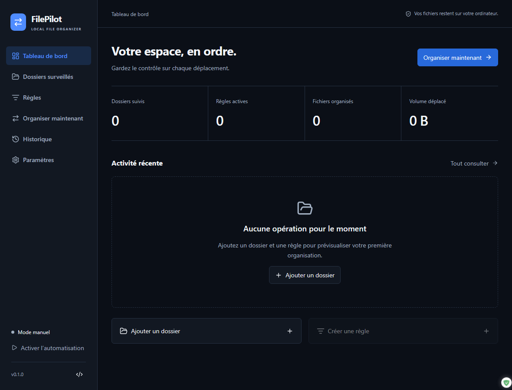

# FilePilot

**Organize your files. Stay in control.**

Application Windows 10/11 x64 gratuite, locale et open source. Tauri 2 / Rust / React / TypeScript / SQLite. Aucun compte, publicité, télémétrie ou transfert de documents.



Capture réelle du frontend dans le navigateur de test, avec une fixture IPC vide. Elle illustre l'interface et ne constitue pas une validation du parcours natif Windows.

## Utilisation

1. Installez un fichier `FilePilot_<version>_x64-setup.exe` validé depuis [GitHub Releases](https://github.com/crype-dev/FilePilot/releases). Les builds locaux ne disposent pas de mises à jour de production.
2. Ajoutez un dossier avec le sélecteur Windows. Aucun dossier n'est sélectionné automatiquement.
3. Créez une règle à partir d'un modèle ou de conditions personnalisées, sélectionnez sa destination puis activez-la.
4. Dans **Organiser maintenant**, lancez la simulation et inspectez les fichiers et destinations. Sélectionnez les opérations puis confirmez.
5. Consultez l'historique et annulez les déplacements éligibles. Activez la surveillance seulement après avoir vérifié les règles.

## Fonctions

- Six écrans reliés au backend Rust, interface français/anglais, thèmes clair/sombre/système.
- Dossiers consentis, surveillance récursive optionnelle, suspension et réconciliation périodique.
- Règles ordonnées : extensions, noms, mots, glob, taille, âge, dates, chemins relatifs et exclusions.
- Déplacements et renommages, noms uniques ou conflit ignoré ; aucun écrasement.
- Simulation réelle, sélection, listes virtualisées, progression et arrêt après l'opération en cours.
- Journal SQLite, vérification BLAKE3, annulation individuelle/groupée protégée et mode sécurisé après interruption.
- Zone de notification, instance unique, démarrage Windows optionnel et notifications groupées.
- Exports JSON, diagnostic sans noms ni chemins, rétention/purge confirmées et import de règles validé (désactivées après import).
- Installateur NSIS par utilisateur et pipeline de publication signé préparé.

Les conditions utilisent **ET** ; plusieurs valeurs d'une même condition utilisent **OU**. La première règle active correspondante décide. Les destinations ne peuvent être situées dans un dossier source. Le modèle de renommage accepte `{name}`, `{ext}`, `{counter}` et `{date}` (numéro du jour Unix en UTC).

## Développement et compilation

Prérequis : Node 24 LTS, Rust stable ≥ 1.90, Visual Studio C++ Build Tools + SDK Windows et WebView2 ([prérequis officiels](https://v2.tauri.app/start/prerequisites/)).

```powershell
npm ci
npm run desktop
npm run build:windows
```

`npm run dev` affiche uniquement le frontend dans un navigateur ; les opérations nécessitent le runtime Tauri. Aucun backend fictif n'est livré.

```powershell
npm run lint
npm test
npm run build
cargo test --manifest-path src-tauri/Cargo.toml --locked
cargo clippy --manifest-path src-tauri/Cargo.toml --locked --all-targets -- -D warnings
cargo test --manifest-path src-tauri/Cargo.toml benchmark_10000_files -- --ignored --nocapture
npx playwright test
```

## Architecture

`src/App.tsx` coordonne les vues modulaires dans `src/features/`. `editors.tsx` contient les formulaires Radix/React Hook Form/Zod, `types.ts` les contrats IPC et `i18n.ts` les traductions. TanStack Query synchronise les données et Zustand la navigation.

`src-tauri/src/` contient les modèles, SQLite/migration, validation des chemins, règles, scanner, opérations journalées, coordination, surveillance et commandes IPC. Les opérations longues s'exécutent hors du thread de l'interface. Le watcher appartient au backend.

## Distribution et limites

Voir [publication et clés de signature](docs/RELEASE.md), [sécurité des fichiers et récupération](docs/SAFETY.md) et [résultats de validation](docs/VALIDATION.md).

Version initiale `0.1.0`, pas une version `1.0` déclarée stable. Les mises à jour de production nécessitent les clés du propriétaire et une release signée. L'absence de ces clés bloque volontairement la publication. Les tests d'installation et de mise à jour doivent être distingués de la compilation.

V1 cible les fichiers locaux sur NTFS. Réseau, jonctions, fichiers en lecture seule et fichiers cloud hors ligne sont exclus. Les déplacements nécessitent de l'espace pour une copie ; l'API Windows préserve les attributs et flux NTFS, avec un test spécifique de `Zone.Identifier`. La récupération des opérations ambiguës est manuelle. La copie en tant qu'action de règle et les raccourcis avancés ne sont pas encore implémentés. Le parcours d'accueil est intégré aux vues principales plutôt qu'un assistant modal en cinq étapes. Certains détails d'erreurs système restent en anglais. L'interface charge les 10 000 dernières opérations et ses compteurs couvrent cet historique affiché.

## Confidentialité, contribution et licence

Les documents ne quittent jamais l'ordinateur. Le réseau sert uniquement aux mises à jour des builds signés et au dépôt GitHub ouvert explicitement. Les données sont persistées dans le répertoire applicatif Windows. Aucun secret n'est requis pour l'utilisation locale.

Licence [MIT](LICENSE). [Inventaire des licences des dépendances](docs/THIRD_PARTY_LICENSES.md). Voir [CONTRIBUTING](CONTRIBUTING.md), [CODE_OF_CONDUCT](CODE_OF_CONDUCT.md) et [SECURITY](SECURITY.md).
